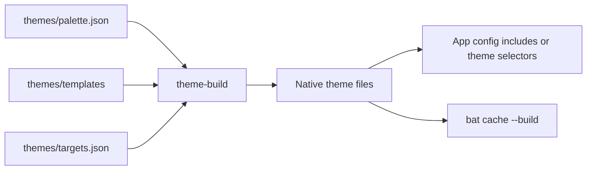

# Shared theme design

[Theme guide](themes.md) · [Sources](../themes/README.md) · [Guide](README.md)

Implemented 2026-10-04. The aim is to change a color once and have the core apps
use it, while keeping each app's normal configuration readable and editable.

## Data flow



The source has three parts. The palette owns RGB values and shared color roles.
Templates assign those colors to each application's UI elements. The target
list says where each template is written. Generated files live beside the app
configs that consume them and are checked into Git.

The generator is a Python 3.9+ script using the standard library. It runs only
when requested. There is no package installation, network access, watcher,
startup hook, or background process. Apps continue to start from their native
configs if Python is unavailable.

## Why native generated files

These apps do not share a configuration language. Some can include a file;
others select a named theme; khal keeps its palette in its main config.
Generating their native formats avoids a runtime adapter for every program.
It also makes a palette change reviewable as an ordinary diff.

An existing theme framework would add another dependency and still need local
templates for this mix of programs. The small generator handles substitution,
validation, and writes. It does not implement a template language, theme server,
plugin system, or application launcher.

Generated files are deliberately committed. A fresh checkout has usable app
configs, and a review can show both the palette change and its effect. The cost
is duplicated output, which `theme-build --check` detects when it becomes stale.

## Palette and template format

[palette.json](../themes/palette.json) has five fields:

| Field | Contract |
| --- | --- |
| `version` | Schema version, currently `1`; unknown versions are rejected |
| `name` | Human-readable palette name; app theme filenames remain stable |
| `colors` | Named, lowercase `#rrggbb` values; the only hand-maintained RGB literals |
| `roles` | One-level references to colors, such as `accent: blue`; cannot shadow color names |
| `ansi` | The standard 16 color names in terminal slot order; order is validated |

Color names describe the palette. Roles describe use: focus, selection, error,
warning, links, and syntax categories. A template can use a named color directly
when that distinction matters, such as nnn's four context colors. Changing
`blue` affects every blue element; changing `accent` affects templates that
explicitly ask for the accent role. It does not redefine ANSI blue.

Templates use four substitutions:

| Token | Expansion |
| --- | --- |
| `@@accent@@` | RGB hex value of the role's color |
| `@@blue.rgb@@` | Decimal `r,g,b` components for Zathura's `rgba(...)` syntax |
| `@@blue.ansi@@` | Terminal slot number, such as `4` |
| `@@blue.ansi_hex@@` | Two-digit hexadecimal slot for nnn, such as `04` |

An ANSI substitution requires a color with an ANSI slot. The default foreground
and background have no slots. Unknown names, malformed tokens, duplicate JSON
keys, invalid values, or invalid role references fail the build. Values are
restricted to colors and indices, so templates never evaluate palette text as
shell, Lua, or Python code.

The templates retain app-specific settings such as heading weight and selection
attributes. Opacity, font choices, layout, keybindings, and application behavior
stay in ordinary configs. Neovim's generated Lua derives subdued diagnostic and
diff backgrounds by mixing palette colors with the background. Those weights
are adapter decisions in the template; they introduce no second RGB palette.

## Ownership and writes

[targets.json](../themes/targets.json) is the output inventory. Most entries own
an entire theme-only file. The main configs include or select those files with
small, hand-maintained statements. Rebuilding never rewrites those main configs.

The exception is khal, which has no theme include directive. Its target names a
`palette` block bounded by:

```text
# BEGIN GENERATED THEME: palette
...
# END GENERATED THEME: palette
```

Only the text between the markers is replaced. Calendar paths, account names,
event formats, keybindings, and all other sections are preserved. Missing,
repeated, or reversed markers are errors. A new checkout already contains them;
the generator does not guess where to insert a block.

Before writing, the generator renders every target and validates the palette,
paths, markers, JSON output, and TextMate XML. It refuses absolute destinations,
parent-directory escapes, duplicate destinations, and symlinked output paths.
Templates must also stay inside their declared directory. A failure during
this planning phase leaves all outputs untouched.

Changed files are written to a temporary sibling and replaced atomically,
preserving existing permission bits. Unchanged files retain their modification
times, which avoids unnecessary WezTerm reloads. The set of files is not one
filesystem transaction: an interruption or disk error during writes can leave
a mixture of old and new files. Fix the error and rerun the build, then check.
Run one build at a time.

`--check` and `--diff` never write. Both exit 0 for current output, 1 for drift,
and 2 for invalid inputs or filesystem errors. `--root PATH` operates on another
checkout, including its palette, templates, and target list. It is useful for
isolated tests; it is not an installation prefix.

## App boundaries

The [theme guide](themes.md#app-coverage-and-reloads) lists every consumer and its
reload method. Native file includes are used for WezTerm, tmux, Neovim, Zathura,
NeoMutt, Newsboat, and zsh. Named themes are used for bat, btop, cmus, and Codex.
bat and Codex receive copies of the same TextMate template.

zsh loads the generated settings after plugin configuration. This prevents fzf
and shell plugin defaults from taking precedence. The directory picker no longer
overrides the shared prompt color. `LS_COLORS` uses the terminal's ANSI slots, so
GNU ls and tree follow the same palette.

cmus saves colors in `autosave`; its static `rc` loads the shared theme after
that file. btop can save the currently selected theme on exit. If an instance
that predates this change restores its old selection, select `shared` once in
btop's options. Generated themes do not rewrite application state or send commands
to running apps.

Neovim keeps the onedark.nvim highlight definitions, with its current palette
overridden by the generated values. lualine and the Prover9 operator override
use the same generated module. A future onedark.nvim release could add palette
keys; review its palette when updating if new colors appear unexpectedly.

NeoMutt uses ANSI slots and retains its existing highlighting expressions.
Its ncurses interface rejects RGB literals under this setup's `tmux-256color`,
even when `color_directcolor` is enabled in the theme. Setting that option off
and using slots keeps the shared colors through WezTerm's palette. The HTML
mode sources a separate generated fragment to preserve the visible mode
indicator. Theme work does not alter mail content or recipient-facing HTML.

Chawan's mail wrapper passes the generated `chawan/mail.css` as a user stylesheet.
It overrides viewing colors while keeping the message layout and images. The
same wrapper serves received mail and compose previews; standalone browsing
does not use this stylesheet. CSS also hides MathML source annotations that
would otherwise appear as duplicate formula text.

Newsboat and cmus use ANSI indices because their installed color interfaces do
not take arbitrary RGB colors. nnn uses ANSI context colors as well. khal uses
RGB values for its interactive palette and terminal color names for calendar
identities. Its 16-color fallback remains usable but has fewer distinctions.

Plannotator exposes a built-in dark/light choice rather than a full palette in
the current config interface. Codex's TextMate theme controls syntax and diff
highlighting, not every UI element. Those limits are explicit; matching a theme
name does not imply full RGB control.

## Validation and review

Run the generator's regression tests and drift check from the config root:

```sh
python3 -m unittest discover -s themes/tests -v
themes/scripts/theme-build --check
git diff --check
```

The tests use temporary checkouts. They check that a palette change reaches RGB,
RGBA, and ANSI consumers; unrelated khal settings survive; no-op builds preserve
file times; previews do not write; and malformed inputs or unsafe paths fail
before output is changed. They also reject independent RGB literals in templates.

The generator validates data and structured output, but does not replace every
application's parser. When editing a template, load the result in its consumer.
For NeoMutt, use an interactive terminal test: a `-Q` variable query skips the
terminal color checks and can succeed for a theme that fails during UI startup.
The test suite includes a pseudo-terminal startup check for normal and HTML-mode
colors under `tmux-256color`, using an empty temporary mailbox. It runs when
NeoMutt is installed and never opens the configured accounts.
For an include-only change, check both the generated file and the include path.
After changing colors, inspect ordinary text, selection, errors, code, and inactive
UI elements in a wide terminal and a narrow pane. Transparency and bold text can
affect perceived contrast even when RGB values match.

`--check` covers generated file contents, not running processes, bat's compiled
cache, or manually changed theme selectors. Rebuild bat's cache after changing
its theme. Application reloads remain explicit so a build does not disturb open
documents, mail composition, or running terminal sessions.

## Adding an app or retiring one

First check the app's native theme mechanism and accepted color format. Add a
template using palette tokens, register its destination in `targets.json`, and
add the include or selector to the app config. Prefer a separate theme file. If
the app cannot include one, add a clearly bounded block as khal does.

Generate, load the result in the app, and document the consumer and reload method.
Add a palette role only when it describes a shared use. App-specific mappings
belong in that app's template. Do not add a new RGB literal to solve one widget's
color without first checking the existing palette.

To retire an adapter, remove its selector/include, target entry, template, and
generated file together. The generator never deletes unlisted files, so removal
is an explicit repository change. To undo a color change, restore the palette
and templates, rebuild, refresh bat's cache, and reload affected apps.

## References

The implementation uses installed app documentation and source where available.
[khal's palette format](https://khal.readthedocs.io/en/latest/configure.html#the-palette-section)
defines its low/high-color entries;
[NeoMutt's color syntax](https://docs.neomutt.org/reference/color/syntax.html)
documents RGB support. Codex's custom TextMate theme interface is documented in
[CLI customization](https://learn.chatgpt.com/docs/cli-customization).
